<div align="center">



<br/>

[`portfolio`](https://developeravik.xyz) · [`linkedin`](https://linkedin.com/in/developeravik) · [`hackerone`](https://hackerone.com/developeravik) · [`youtube`](https://www.youtube.com/@DreadSprecter) · [`mail`](mailto:developeravikdas@gmail.com)


</div>

```console
avik@root:~$ cat about
```
```
Security architect and full-stack engineer. I attack what I build before anyone
else does. Sole founder and engineer of every project below, from threat model
to production. Day to day: web and Active Directory offense, exploit
development, and secure AI and healthcare systems.
```

```console
avik@root:~$ cat status
```
```yaml
shipping:    SheGuardAI             # AI-driven safety platform
studying:    exploit development    # stack/heap, shellcode, mitigation bypasses
cert_track:  OSEP                   # in progress
consulting:  ThinkCloudly           # cloud hardening, vulnerability analysis
```

```console
avik@root:~$ cat certs
```
```
OSCP    Offensive Security Certified Professional      passed
eWPTX   Web Application Penetration Tester eXtreme     passed
CRTA    Certified Red Team Analyst                     passed
eJPT    Junior Penetration Tester                      passed
OSEP    Offensive Security Experienced Pen Tester      in progress
```

```console
avik@root:~$ cat tradecraft
```
```
offense      Burp Suite · Metasploit · Nmap · sqlmap · ffuf · Gobuster · Nuclei
             OWASP ZAP · Nessus · Wireshark · Hydra
active-dir   BloodHound · Impacket · Hashcat · John
exploit-dev  x86/x64 asm · GDB · pwndbg · x64dbg · Ghidra · IDA · radare2
             ROP · shellcode · buffer overflow · format string
languages    Assembly · C · C++ · Python · TypeScript · JavaScript · Go · Bash · SQL
build        Next.js · React · Node.js · Express · MongoDB · PostgreSQL · Redis
             Prisma · Docker · AWS · PyTorch
```

```console
avik@root:~$ ls work/
```
```
SheGuardAI       building   AI-driven safety platform, real-time threat detection
                            PyTorch · Python
MyHealthMirror   shipped    privacy-first healthcare: patient-owned records,
                            AI insights, hardened auth
                            Next.js · Node.js · PostgreSQL
Connect AI       shipped    AI ecosystem for automation, retrieval and
                            scalable microservices
                            PyTorch · Python
```

```console
avik@root:~$ cat research
```
```
ieee         7 papers published in 2026, all on IEEE Xplore
  journal      1 Q1 (indexed)
  conference   6 (security, AI)
patents      10 in progress (healthcare blockchain, AI diagnostics, secure systems)
```

<!-- TODO: add paper titles + IEEE Xplore/DOI links, HackerOne stats, CVE IDs and writeup links here once available -->

<details>
<summary><code>flagship patents</code></summary>

<br/>

**Decentralized Blockchain Medical Ledger** · healthcare, cryptography
Immutable medical-record storage with cryptographic verification and secure cross-device sync.

**AI Deep-Learning Real-Time Diagnostics** · applied AI, medtech
Edge-optimized deep-learning inference for real-time medical imaging analysis.

</details>

```console
avik@root:~$ cat teaching
```
```
udemy     1,900 learners · 6 courses · 70 reviews
youtube   @DreadSprecter
```

<details>
<summary><code>courses</code></summary>

<br/>

| course | rating | content |
|:--|:--|:--|
| [Real-World Penetration Testing Bootcamp \| Web, Network & AD](https://www.udemy.com/course/ethical-hacking-bootcamp-2024/) | 4.5 (51) | 27h · 107 lectures |
| [Mastering Advanced Web Hacking & Penetration Testing 2026](https://www.udemy.com/course/mastering-advanced-web-hacking-penetration-testing-2026/) | 5.0 (2) | 18.5h · 71 lectures |
| [Web Application Penetration Testing Mastery](https://www.udemy.com/course/web-application-penetration-testing-mastery/) | 4.7 (9) | 6.5h · 16 lectures |
| [Live Penetration Testing: Hands-On Labs](https://www.udemy.com/course/live-black-hat-hacking-course/) | 4.9 (2) | 2.5h · 5 lectures |
| [The Art of Malware Creation](https://www.udemy.com/course/malware-development-for-red-teamming/) | 3.8 (6) | 2h · 12 lectures |
| [AI & Machine Learning From Scratch](https://www.udemy.com/course/ai-machine-learning-from-scratch-build-real-world-models/) | unrated | 3.5h · 12 lectures |

</details>

```console
avik@root:~$ git log --graph --author=avik
```

<div align="center">


</div>

```console
avik@root:~$ mail -s "let's build something secure" developeravikdas@gmail.com
```
